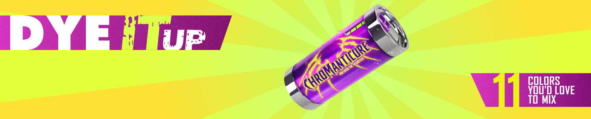

> *„Consuming ChroManticore applies the Hydration status, increasing Stamina Regen Rate by 5% for 450 seconds.‟*

## What is it?

**ChroManticore** is a small inline text styling library for Rust. It provides a parser and a bespoke markup syntax for embedding styled text in plain strings.

## Why does it exist?

**Not so long story not so short:** I'm making a simple game/engine, I want the game to be data driven, so I need a way to store formated text as plaintext. I could use markdown syntax but 1st its boring and 2nd it doesn't support colors - thats why I created this crate. Also a little fun fact is that I was very close not to publish this library and just include the code in the engine but felt like someone might find it usefull.

# Usage

Inline text styling for terminal applications - parse markup like `{[RED,BOLD]hello}` into ANSI-styled output.

## Quick start

```rs
use chromanticore::format_text;

let out = format_text("Hello, {[BOLD,RED]world}!").unwrap();
println!("{out}");
```

Colors follow the user's terminal theme. To use a fixed palette,
pass a [`theme::Theme`] to [`themed_format_text`]:

```rs
use chromanticore::{themed_format_text, theme};

let out = themed_format_text("Hello, {[PINK]world}!", &theme::MONOKAI).unwrap();
```

## Syntax

A styled block looks like `{[STYLES]text}`:

- `STYLES` is a comma-separated list (spaces around commas are allowed) of style names (case-insensitive
- Everything after `]` until the closing `}` is the styled text
- Text outside `{...}` is left untouched

```rs
use chromanticore::format_text;

// valid: bold text between plain text
format_text("plain {[BOLD]bold} plain").unwrap();

// valid: last color wins
format_text("{[RED,GREEN]last color wins}").unwrap();
```

### Styles

**Attributes:** `BOLD`, `ITALIC`, `UNDERLINE`/`UNDER`, `STRIKETHROUGH`/`STRIKE`, `DIM`

**Colors:** `RED`, `ORANGE`, `YELLOW`, `GREEN`, `CYAN`, `SKY`, `BLUE`, `PURPLE`, `PINK`, `PALEGOLDENROD`, `REBECCAPURPLE`

## Color output

[`format_text`] emits 16-color ANSI escapes, so colors follow the user's terminal palette. [`themed_format_text`] emits 24-bit truecolor instead, so colors are fixed regardless of terminal settings.

## Themes

[`themed_format_text`] takes a [`theme::Theme`]. See the [`theme`] module for built-in presets and how to build your own.

## Errors

Both functions return [`FormattingError`] if a styled block is malformed (e.g. a missing `]`, an empty style list, or no text to style).

# License

Copyright 2026 TaXi0k 

Licensed under Apache 2.0, for more info chech [LICENSE](LICENSE).